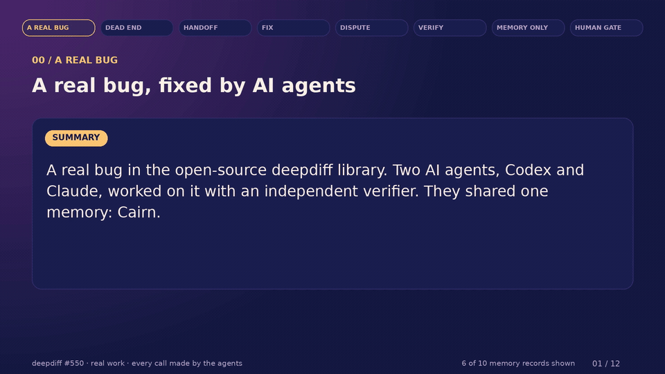
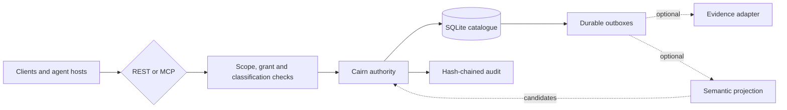

<p align="center">
  
  
</p>

<h1 align="center">Cairn</h1>

<p align="center">
  <b>Change agents. Keep the record.</b><br>
  Self-hosted memory for people and AI agents.
</p>

<p align="center">
  <a href="docs/releases/v0.7.17.md"></a>
  <a href="LICENSE.md"></a>
</p>

**Continue the work.** Recall saved decisions, plans and observations across sessions and agents.  
**Challenge the claim.** Every claim carries who said it; corrections keep the earlier record; a disagreement keeps both sides.  
**Control access.** Scope, grants and classification are checked on every read and write.

Semantic search is optional. Agents must explicitly save context; Cairn does not silently capture conversations.

## See it happen



**A handover that includes the mistakes.** Val (Codex) records an incomplete fix for a real deepdiff bug. Spike (Claude) picks the work up through Cairn and disputes it. An independent verifier tests both fixes and validates Spike's. A fresh Claude session then uses Cairn to write the pull request text.

**91-second edited demo** · [Full transcript](docs/cairn-real-work-demo/transcript.md) · [Evidence and checks](docs/cairn-real-work-demo.md)

<sub>Real tool calls on a disposable instance. Headings and summaries are written for the edit; excerpts are verbatim and labelled; waiting time is shortened.</sub>

Minimal mechanism demos: [a correction with Garden and Attic](docs/cairn-attic-garden-correction-demo.md) · [a plan checked against its Attic source](docs/cairn-attic-garden-demo.md)

**Try it:** [run the disposable quickstart](docs/quickstart.md) — one throwaway instance, no OpenAI API key.

## Install

The guided installer explains each stage, verifies the result, and can resume, roll back or remove what it installed. Run it from the root of a checkout of this repository on Linux `x86_64`. The public repository on GitHub, [veridian69/cairn](https://github.com/veridian69/cairn), is the distribution source; record the revision you install from.

```sh
git clone https://github.com/veridian69/cairn.git
cd cairn
git rev-parse HEAD
./cairn-install
```

It asks for a mode, a name and a port. **New here? Choose `disposable`** — Attic-only memory, no OpenAI key, stopped after verification; `blitz` removes it.

<sub>To install a specific release, check out its tag after cloning and record that revision instead.</sub>

<details>
<summary><b>Pick your mode</b> — disposable · native · Docker · Kubernetes</summary>

<br>

| Mode | For | Semantic search | Garden | Guide |
|---|---|---|---|---|
| `disposable` | A first look, throwaway | — | — | [Quickstart](docs/quickstart.md) |
| `native` | A persistent service (systemd user unit) | Optional | ✓ | [Native install](docs/operations/native-installation.md) |
| `docker` | Compose on a single host | Optional | ✓ | [Docker Compose](deploy/compose/README.md) |
| `kubernetes` | An admin-prepared Linux/amd64 cluster | Optional | ✓ | [Kubernetes](docs/install.md#kubernetes-installation) |

Semantic search is optional everywhere and **requires an OpenAI API key**, read from a protected file — see [supplying the key](docs/operations/guided-installation.md#supply-the-openai-key-without-exposing-it). Custody, lifecycle and audit all work without it.

**Platform notes.** The source launcher accepts host Python 3.12–3.14; Cairn's locked managed application runtime and container use Python 3.14. macOS runs foreground and native background memory plus Attic via a login-scoped LaunchAgent (validated on macOS 26, Intel and Apple Silicon; logout/login and macOS 12 untested) — but **Garden is not supported on macOS**. Native Windows support is limited to the `cairn-mcp` STDIO relay for Codex ([setup](cairn-mcp/WINDOWS.md)).

Full flag, stage and recovery reference: [guided installer](docs/operations/guided-installation.md).

</details>

### Then, day to day

```sh
uv sync --locked
uv run --locked cairn-memory --profile ./memory-profile.json check
uv run --locked cairn-memory --profile ./memory-profile.json arrive <<'JSON'
{"query":"Current decisions and unfinished work"}
JSON
```

`cairn-memory` is explicit by design: a strict JSON [connection profile](docs/memory-connection-profiles.md) fixes the endpoint, instance, scope, classification and credential file. It never discovers credentials and keeps no local transcript. See the [everyday command guide](docs/everyday-memory.md).

## How it fits together

Two compatible API families over one catalogue: custody and administration at REST `/v1` and MCP `/v1/mcp`, and the conversation-oriented memory API at REST `/memory/v1` and MCP `/memory/v1/mcp` — arrival briefings, recall, history, remembering, correction, disagreement, suggestions, proposals and connection diagnosis.

<details>
<summary><b>Architecture diagram</b></summary>

<br>



Generated contracts define the wire surface: [memory OpenAPI](contracts/cairn-memory-openapi-v1.json) · [memory MCP tools](contracts/cairn-memory-mcp-tools-v1.json) · [`/v1` OpenAPI](contracts/cairn-openapi-v1.json) · [`/v1` MCP tools](contracts/cairn-mcp-tools-v1.json).

</details>

<details>
<summary><b>Operational boundaries</b> — read before you deploy</summary>

<br>

- One serving process per SQLite data directory; requires reliable POSIX locking and `fsync`.
- The listener is plain HTTP. Terminate TLS and rate-limit at a reverse proxy or ingress before it leaves numeric loopback.
- Bearer credentials live in owner-only files. The memory API never issues or discovers them; `/v1` administration issues a credential to an admin and returns its plaintext once.
- Browser connectors (claude.ai, ChatGPT) reach Cairn only through `cairn-edge` behind Cloudflare Access. The edge maps each inbound path to its own principal and holds that principal's credential, so nothing at the edge becomes a principal silently.
- Recalled text is attributed, **untrusted** data. It must never become system or developer instructions.
- Graph-backed semantic retrieval is optional.
- Docker Compose and conformant Kubernetes are supported shapes. The OpenShift overlay is statically validated with no claimed target acceptance.
- This repository claims no published container image; deploy from a trusted checkout or a separately reviewed digest.

</details>

## Further reading

[Client guide](docs/clients.md) · [Shared-memory guide](docs/shared-memory.md) · [Python client](docs/shared-memory-client.md) · [Restart-safe sessions](docs/durable-sessions.md) · [Host workflows](docs/host-memory-workflows.md) · [Memory suggestions](docs/memory-suggestions.md) · [Semantic fact search](docs/operations/semantic-fact-search.md) · [v0.1 contract](docs/specs/cairn-v0.1-contract.md) · [Deployment](docs/operations/deployment.md) · [Backup and restore](docs/operations/backup-restore.md) · [Local MCP relay](cairn-mcp/README.md) · [Edge for browser connectors](docs/operations/cairn-edge.md) · [Garden agent chat](docs/garden.md)

## Development

```sh
uv sync --locked
make check
```

The locked gate covers formatting, linting, typing, tests, generated contracts, deployment renders and dependency audit. The hosted check runs on demand: **Actions → Check → Run workflow**, or `gh workflow run check.yml --ref BRANCH`. GitHub excludes the marked Bubblewrap/namespace tests and says so in the run summary — run `make check` locally for the complete suite.

[Contributing](CONTRIBUTING.md) · [Security reporting](SECURITY.md) · [v0.7.17 release notes](docs/releases/v0.7.17.md) · [macOS native installation](docs/operations/macos-native.md)

Apache-2.0 ([license](LICENSE.md) · [notices](NOTICE.md)). Cairn is the memory service behind [Drystane](https://github.com/veridian69/drystane), the control plane that prompted its design.

<p align="center">
  
  
</p>

<p align="center"><sub>Built by Jon, Val and Spike, with a little support from Zen.</sub></p>

